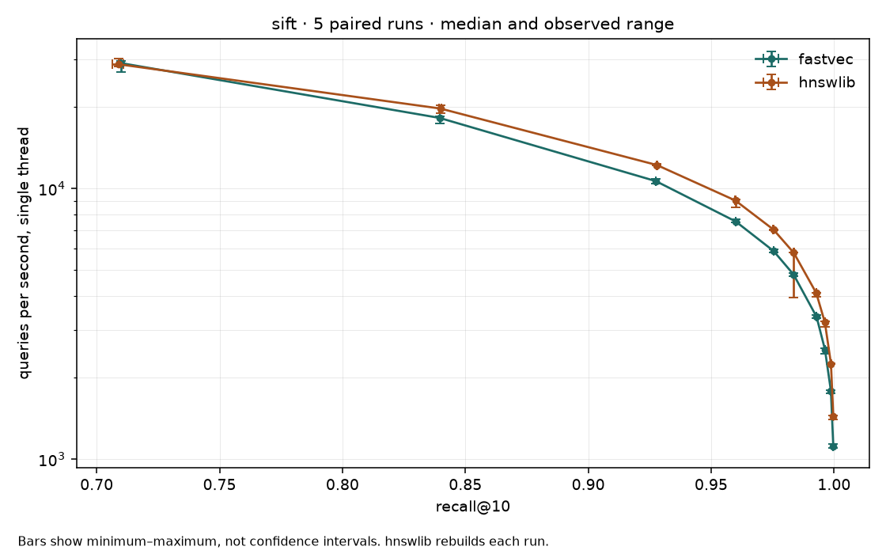

# fastvec

Vector similarity search engine, written from scratch in Go.

Implementing HNSW from the paper rather than calling a library, and benchmarking
it against hnswlib on SIFT1M with everything running on a laptop CPU.
A FAISS comparison is planned.

The [security review](docs/security-review.md) records input checks, dependency
audits and current limitations. Dataset and index loaders expect trusted local
files.

## Results

Five paired SIFT1M runs on 2026-10-19 using `search_only_repeated_sweeps_v2`.
One million 128-dimensional vectors, 10,000 queries, M=16,
efConstruction=200, k=10, and one query thread. Search timing excludes recall
evaluation. Run order alternates between implementations.

| ef | Fastvec recall | Fastvec median QPS [min–max] | hnswlib recall | hnswlib median QPS [min–max] |
|---:|---:|---:|---:|---:|
| 10 | 0.7099 | 28,979 [26,833–29,575] | 0.7090 | 28,696 [28,194–30,215] |
| 60 | 0.9599 | 7,551 [7,481–7,682] | 0.9598 | 9,021 [8,529–9,078] |
| 100 | 0.9835 | 4,808 [4,737–4,879] | 0.9836 | 5,783 [3,964–5,808] |
| 500 | 0.9997 | 1,119 [1,101–1,140] | 0.9997 | 1,442 [1,399–1,450] |

Recall columns show medians. Brackets show the observed minimum and maximum
across five runs, not confidence intervals. Machine idleness was not verified.
An unfinished fourth-pair attempt was interrupted after an unexplained long delay
and restarted; the session report records this interruption.
Go calls Search per query; Python uses hnswlib's batch API, so API overhead and
allocations remain included. These measurements do not establish a universal
speed advantage.

Fastvec reused the same validated SIFT1M index; hnswlib rebuilt its graph each
run. Variation therefore includes graph construction for hnswlib. No build-time
comparison is claimed. Full samples, recall ranges and commands are retained in
the [SIFT1M session](bench/results/repeated-sift-20261019/summary.md).
The [five-pair SIFT-small report](bench/results/repeated-siftsmall-20261019/summary.md)
and [methodology](docs/benchmarks.md) provide additional context.

A [current-code Ubuntu/WSL2 session](docs/ubuntu-baseline-20261021.md) records
four pairs on 2026-10-21. SIFT1M throughput drifted substantially during that
session; it is exploratory and kept separate from the Windows results above.

## What is implemented here

[Search profiling](docs/search-profiling.md) records the measured CPU costs and
the result-sorting change that reduces query allocations from three to one.
A compact bottom-layer layout also reduced median query time by 4.0% at ef=100
and 6.5% at ef=500 in three local before/after pairs, with identical search results.
The report documents retained and temporary memory costs. The repeated benchmark
figures above predate these changes.

The [two-pass loader](docs/load-profiling.md) fills compact graph storage directly
for seekable inputs. In three local SIFT1M pairs, median peak process memory fell
12.4% and load time fell 4.0%; streaming inputs retain the original loading path.
An explicit `LoadOptions{SinglePass: true}` option avoids graph rereads when
read bandwidth matters more than temporary memory; see the loader report for
the controlled slow-read simulation and its limits.
For the benchmark CLI, select `-index-load-policy auto` (default) or
`-index-load-policy single-pass`. Results record the requested policy; it only
affects loading an existing index cache.

[16-bit visited-node stamps](docs/stamp-width-20261022.md) halve the stamp array
from 4 MB to 2 MB per million-node search workspace. Four local alternating
pairs observed 4.0% lower median query time at ef=100, with no clear gain at
ef=500. Epoch rollover now clears the array every 65,535 layer searches; the
report documents that latency tradeoff and correctness checks.

No third-party libraries on the query path. The `.fvecs` parser, distance
kernels, top-k heap, graph construction, search, and on-disk format are all in
this repository. hnswlib is used only as a benchmark opponent.

Go standard library only, plus CPU feature detection written by hand rather than
pulled from `golang.org/x/sys`.

## Running

Use Go 1.26.9 or a newer supported patch release. The recorded benchmark
environment below describes the earlier measurements, not the current minimum.

    make test          # unit tests
    make bench         # HNSW on SIFT1M, sweeps ef, writes JSON
    make baseline      # hnswlib on the same data
    make plots         # draw both curves

CI runs the short Go suite on Linux and Windows in default, `purego`, and
`diagnostic` builds, plus a Linux race-detector job and Python timing tests.
The short suite includes synthetic recall checks against exact Flat search:
uniform, clustered, and duplicate vectors, three seeds, and sequential/four-worker
builds. No dataset download is needed. These regression checks require recall@10
of at least 0.95 sequentially and 0.90 in parallel; they do not replace SIFT
measurements. Dataset-dependent tests remain available through `make test`.

Benchmarks can reuse a saved index to avoid rebuilding the graph. Datasets are not in the repo; see `data/README.md`.

Before reusing an index, the benchmark checks its stored construction settings
and compares every vector against the requested dataset, including row order.
A mismatch returns an error; choose a different `-index` path or remove the old
cache to rebuild. Changing query-time `efSearch` does not require rebuilding.
This check works with existing index files. Format v1 does not record the build
worker count, so cache validation cannot verify that part of build provenance.

## Machine

The current results use native Windows/amd64 on an Intel Core i7-12650H,
Go 1.26.5, Python 3.12.14 and hnswlib 0.8.0. CPU only, one query thread.
Historical WSL2 results are archived separately.

Full numbers in [benchmarks](docs/benchmarks.md), reasoning in `docs/decisions.md`.

MIT licence.
