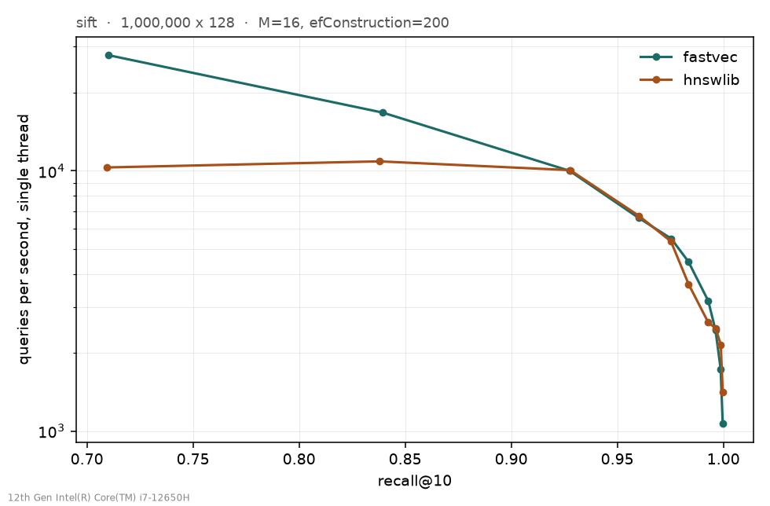
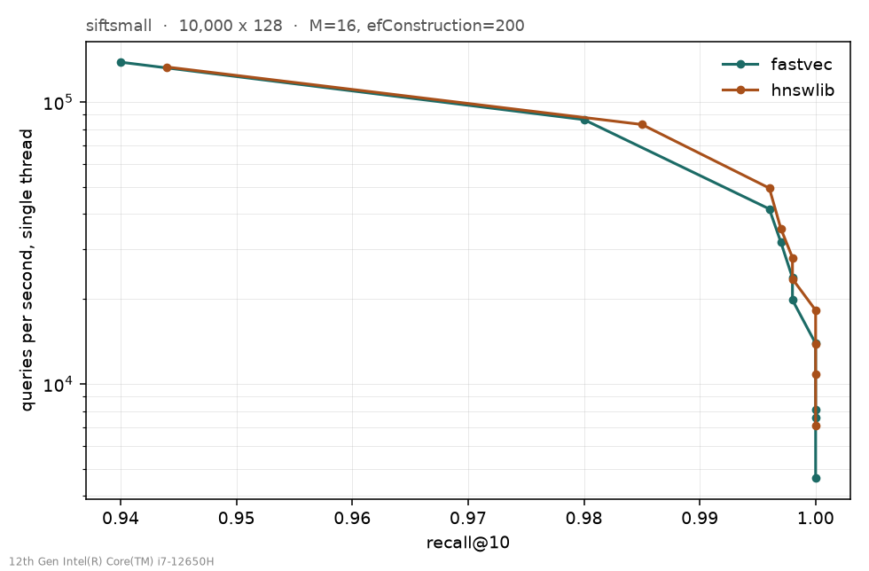

# Benchmarks

## Current Ubuntu session

The [2026-10-21 Ubuntu/WSL2 report](ubuntu-baseline-20261021.md) measures the
current code with four alternating pairs per dataset. It retains all raw runs
and hashes, and documents substantial SIFT1M throughput drift. Treat it as an
exploratory session, separate from the historical native Windows comparison.

## Repeated measurements

Use `py/repeat_benchmarks.py` to collect separate process runs, alternating
Fastvec-first and hnswlib-first order. The default is five pairs (at least three
are required). Commands run sequentially to avoid competing with each other.
Every raw JSON is retained under `run-01`, `run-02`, etc. `summary.json` records
the samples, median, minimum and maximum for each ef; `summary.md` is readable
without additional tools. The output directory must be new. Failed sessions
are marked in `session.json` and do not publish a completed summary.

```powershell
go build -o fastvec-bench.exe ./cmd/fastvec-bench
python py/repeat_benchmarks.py --fastvec ./fastvec-bench.exe --data D:/data/siftsmall --name siftsmall --runs 5 --out bench/results/my-siftsmall-session
```

For SIFT1M, use `--data D:/data/sift --name sift` and optionally
`--index D:/data/sift.fvi` to reuse a validated Fastvec graph. hnswlib rebuilds
its graph on each run, so these repetitions include graph-construction variation
as well as query-timing variation. Build time is not included in QPS. Each median
weights process runs equally; durations are not pooled. Min/max ranges describe
observed spread, not confidence intervals. Five pairs alternate first position
3:2; use an even count if equal order counts are required.

Completed five-pair sessions are available for
[SIFT1M](../bench/results/repeated-sift-20261019/summary.md) and
[SIFT-small](../bench/results/repeated-siftsmall-20261019/summary.md).
The README now uses the repeated SIFT1M results. The original single-run
measurements below are retained for reference, not mixed into these medians.

The SIFT1M session was interrupted during the first attempt at pair 4 after an
unexplained long delay. That attempt produced no completed JSON; pairs 1–3 were
retained and pair 4 was restarted before completing pair 5. `session.json` retains
the attempted command and interruption note. All five completed pairs, including
the slower ef=100 observation in pair 4, contribute to the summary. Treat this as
an exploratory laptop measurement, not a controlled uninterrupted experiment.


Regenerate the repeated-run chart with:

```powershell
python py/plots.py --session bench/results/repeated-sift-20261019
```

Both sessions used the environment and hnswlib package described below. The
same Fastvec executable and SIFT1M cache were reused from the original run.
Each session retains its actual command order and each raw result's environment
metadata. The existing measurement-environment.json hashes describe the original
run's sources and datasets; they are not a snapshot of subsequently added tooling.

## Original single paired run

Measured on 2026-10-19 using `search_only_repeated_sweeps_v2`, with
search and recall evaluation timed separately. SIFT1M contains one million
128-dimensional vectors and 10,000 queries. Both implementations use M=16,
efConstruction=200, k=10, and one query thread.

## SIFT1M

| ef | Fastvec recall@10 | Fastvec QPS | hnswlib recall@10 | hnswlib QPS |
|---:|---:|---:|---:|---:|
| 10 | 0.7099 | 27,837 | 0.7094 | 10,301 |
| 20 | 0.8395 | 16,734 | 0.8378 | 10,871 |
| 40 | 0.9275 | 9,999 | 0.9277 | 10,059 |
| 60 | 0.9599 | 6,603 | 0.9601 | 6,722 |
| 80 | 0.9754 | 5,489 | 0.9753 | 5,356 |
| 100 | 0.9835 | 4,474 | 0.9836 | 3,663 |
| 150 | 0.9929 | 3,161 | 0.9928 | 2,617 |
| 200 | 0.9963 | 2,439 | 0.9963 | 2,485 |
| 300 | 0.9987 | 1,730 | 0.9988 | 2,146 |
| 500 | 0.9997 | 1,067 | 0.9997 | 1,411 |



## SIFT-small

| ef | Fastvec recall@10 | Fastvec QPS | hnswlib recall@10 | hnswlib QPS |
|---:|---:|---:|---:|---:|
| 10 | 0.9400 | 138,266 | 0.9440 | 132,905 |
| 20 | 0.9800 | 86,478 | 0.9850 | 83,115 |
| 40 | 0.9960 | 41,701 | 0.9960 | 49,437 |
| 60 | 0.9970 | 31,758 | 0.9970 | 35,482 |
| 80 | 0.9980 | 23,746 | 0.9980 | 28,028 |
| 100 | 0.9980 | 19,815 | 0.9980 | 23,541 |
| 150 | 1.0000 | 13,896 | 1.0000 | 18,232 |
| 200 | 1.0000 | 8,079 | 1.0000 | 13,822 |
| 300 | 1.0000 | 7,568 | 1.0000 | 10,796 |
| 500 | 1.0000 | 4,626 | 1.0000 | 7,121 |



## Method and limitations

Both runners time whole search-only sweeps, doubling repetitions until the
attempt lasts at least 100 ms. Only the final attempt contributes to QPS.
JSON records the measured query count and duration. Recall is evaluated in a
separate pass. Repeated sweeps measure a warmed workload.

Go's individual latency samples in this environment are visibly quantized
(including zero samples and approximately 1 ms increments). Do not use these
percentiles as precise latency estimates. Aggregate throughput uses longer
intervals and does not average those individual samples.

These are single paired runs, without confidence intervals or verified idle
machine conditions. Throughput varies across settings; these results do not
establish a universal speed advantage. Go calls Search per query; Python uses
hnswlib's batch API, so API overhead and allocations remain included.

The SIFT1M Fastvec graph was loaded from an existing cache and validated against
every input vector and persisted construction parameter. Its `build_seconds: 0`
means no build was measured, not a free build. Format v1 does not record the
original build worker count. hnswlib built a new graph; build times are therefore
not directly comparable. SIFT-small built fresh graphs for both implementations.
No new Flat, FAISS, memory-usage or distance-kernel benchmark was performed.

## Environment and reproduction

Native Windows/amd64, Intel Core i7-12650H (16 logical CPUs), Go 1.26.5 with
AVX2 enabled, Python 3.12.14, NumPy 2.3.5 and hnswlib 0.8.0. Query threads: one.
Run order: Fastvec SIFT-small, hnswlib SIFT-small, Fastvec SIFT1M, hnswlib SIFT1M.
Raw JSON includes UTC timestamps and reports the source checkout as dirty at
commit `f4ad685`; the commit alone does not identify the measured source.
`bench/results/measurement-environment.json` records source and dataset hashes.

hnswlib used the prebuilt conda-forge Windows Python 3.12 package
`hnswlib-0.8.0-py312h9b46583_2.conda`, SHA256
`3a4510cbe62013478b171496a7bc362abf629b04a6db8ffa8a502607f3ef1e47`, from
[conda-forge](https://conda.anaconda.org/conda-forge/win-64/hnswlib-0.8.0-py312h9b46583_2.conda).
Compiler settings are those of that package; they are not assumed equivalent
to the historical Linux build.

From the repository root, with datasets and dependencies available:

```powershell
go run ./cmd/fastvec-bench -data D:/data/siftsmall -name siftsmall -out bench/results
python py/bench_baselines.py --data D:/data/siftsmall --name siftsmall --out bench/results
go run ./cmd/fastvec-bench -data D:/data/sift -name sift -index D:/data/sift.fvi -out bench/results
python py/bench_baselines.py --data D:/data/sift --name sift --out bench/results
python py/plots.py
```

The archived [historical measurements](benchmarks-historical.md) used different
timing and environment conditions. Their JSON and plots are preserved under
`bench/results/historical` and `bench/plots/historical`. Do not use the change
between historical and current QPS as an implementation speedup measurement.
