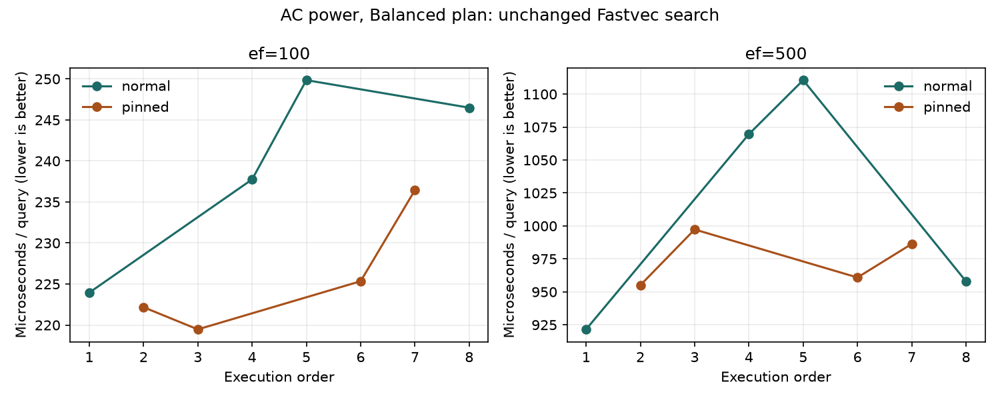

# AC-powered search repeat and CPU profiles — 2026-10-22

Eight fresh processes repeated the prior stability experiment using the same
compiled binary (SHA-256 matched), source, SIFT1M index and query files. All 16
before/after snapshots reported AC Online with the Balanced plan. These snapshots
do not continuously monitor power or host load. The binary and source match
commit `f7d70d0f38353fbbe321d0a3efd54ab668aabdb5`; only documentation/results differ
in the checkout. Source and input hashes were verified before and after.

## Repeatability

| ef | Scheduling | Median µs/query | Observed min–max µs/query | Range / median |
|---:|---|---:|---:|---:|
| 100 | normal | 242.1 | 224.0–249.9 | 10.7% |
| 100 | pinned | 223.8 | 219.5–236.4 | 7.6% |
| 500 | normal | 1,013.8 | 921.5–1,110.6 | 18.6% |
| 500 | pinned | 973.6 | 955.1–997.3 | 4.3% |

Range / median is `(maximum - minimum) / median`, not a confidence interval.
All samples are retained. Every run used 896 B/query and one allocation at
ef=100, and 4096 B/query and one allocation at ef=500.

Pinning was more consistent in this AC session, but the previous battery session
favoured normal scheduling at ef=100. There is no consistent cross-session basis
for a permanent affinity change. Normal scheduling still varied by 10.7% and
18.6%, so AC power did not establish a stable baseline for small speed claims.

The prior battery session's normal medians were 262.7 and 1,109.0 µs/query;
the AC session's normal medians are 242.1 and 1,013.8. These are separate sessions,
not alternating power-state trials. Power, load, temperature and scheduling were
not independently controlled, so the difference is not an isolated AC-power effect.
Neither session establishes the cause of the earlier large throughput drift.

## Method and artifacts

Four pairs alternate normal/pinned and pinned/normal, with one Go execution CPU,
a full 10,000-query warmup, and exactly 10,000 measured searches at each ef per
process. Pinned means WSL virtual CPU 0, not a guaranteed physical performance
core. Loading and warmup are excluded from timing. This measures search against
a saved graph, not graph construction, hnswlib performance or recall anew.

- [Session, exact commands and host snapshots](../bench/results/search-stability-ac-20261022/session.json)
- [All summary samples](../bench/results/search-stability-ac-20261022/summary.json)
- [Previous experiment and reproduction commands](search-stability-20261021.md)
- [Source and input hash manifest](../bench/results/ubuntu-baseline-20261021/environment.json)

The eight `pair-*.txt` artifacts contain the raw Go benchmark output. The same
reproduction commands apply; save each new run separately and record power state.
No power plan, global affinity or production source was changed.

## CPU profiles

After all unprofiled repeats completed, two separate normal-scheduling processes
profiled the same binary: 100,000 measured searches at ef=100 and 30,000 at ef=500,
GOMAXPROCS=1. These runs are excluded from the timing summary above. The profiles
include loading, warmup and Go benchmark calibration as well as measured search;
percentages below are flat CPU sample shares across the whole process.

| Function | ef=100 | ef=500 |
|---|---:|---:|
| AVX2 squared-distance kernel | 63.03% | 63.80% |
| Visited-node stamp lookup | 12.28% | 12.61% |
| Neighbor access | 7.52% | 7.94% |
| Result heap sift-down | 2.90% | 2.76% |

These sampled costs can include cache/memory stalls charged to the accessing
instruction. They do not prove that arithmetic or any specific cache is the
bottleneck, nor establish the speedup available from a change.

[ef=100 profile summary](../bench/results/search-stability-ac-20261022/profiles/ef100-top.txt)
and [ef=500 profile summary](../bench/results/search-stability-ac-20261022/profiles/ef500-top.txt)
retain the exact sample totals. Raw `.cpu` files, benchmark output and
[commands](../bench/results/search-stability-ac-20261022/profiles/commands.json)
are alongside them. The repeated-run power snapshots precede these profile runs;
power was not sampled separately during profiling.

## Next code experiment

Investigate a 16-bit visited-node stamp array in `internal/index/workspace.go`.
The current 32-bit array takes 4,000,000 bytes per workspace for SIFT1M; 16-bit
stamps would take 2,000,000 bytes, potentially improving cache residency. This is
a hypothesis, not an implemented improvement. The tradeoff is a full clear on
epoch rollover every 65,535 searches instead of every roughly four billion.

A candidate must explicitly test rollover and workspace growth, preserve search
results and concurrency safety, and measure amortized and rollover latency.
Compare alternating unchanged/candidate binaries against the identical graph at
both ef values, retaining all observations. Keep it only if the memory benefit
and measured performance tradeoff justify it; current noise cannot establish a
small throughput gain on its own. Distance/vector access remains the largest
sampled cost and the next area if this smaller experiment is unhelpful.
