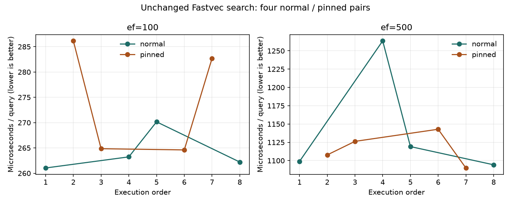

# Ubuntu search stability experiment — 2026-10-21

Eight fresh processes compared normal scheduling with affinity to WSL virtual
CPU 0, four alternating pairs. The unchanged source is commit
`f7d70d0f38353fbbe321d0a3efd54ab668aabdb5`, matching the earlier Ubuntu baseline's
source hashes. Documentation/results were uncommitted; code hashes were verified
before and after measurement. One compiled test binary was reused throughout.

## Result

Pinning did not improve both search settings. Keep normal scheduling as the
current default; the evidence does not justify changing it globally.

| ef | Scheduling | Median µs/query | Observed min–max µs/query | Range / median |
|---:|---|---:|---:|---:|
| 100 | normal | 262.7 | 261.0–270.2 | 3.5% |
| 100 | pinned | 273.8 | 264.6–286.2 | 7.9% |
| 500 | normal | 1,109.0 | 1,094.3–1,263.6 | 15.3% |
| 500 | pinned | 1,117.0 | 1,089.9–1,142.9 | 4.7% |

Range / median is `(maximum - minimum) / median`, not a confidence interval.
Normal scheduling was more consistent at ef=100; pinning was more consistent at
ef=500. The latter includes one slow normal sample, retained in the report.
There are only four observations per condition; these observations do not
establish a general scheduling advantage. All runs allocated once per query:
896 bytes at ef=100, 4096 bytes at ef=500.



## Host observations

Windows reported `AC: Offline` and the Balanced power plan in every before/after
snapshot. Battery charge reported 100%. This is the operating-system-reported
power state; it does not establish why the earlier session sped up.
Available Windows CPU-load snapshots ranged from 0% to 52%; some were unavailable.
They are point samples outside the timed region, not a continuous measure of
competing CPU load. Snapshot clock fields are not measured per-core frequencies.
Thermal state was not measured. No power or system scheduling settings changed.

The earlier large throughput jump did not recur, but this uses a different
measurement harness. Its timings cannot be subtracted from the earlier CLI
results as a speedup. Remaining variation can obscure a small optimization.

## Method

`BenchmarkHNSWSearch` loads the same SIFT1M graph and queries as the earlier
baseline, warms all 10,000 queries for each ef, and times exactly 10,000 searches.
GOMAXPROCS and the Go benchmark CPU setting are one. Both ef=100 and ef=500 run
in each process. Go benchmark calibration can execute additional setup and
warmup; only the reported 10,000-iteration measurement contributes ns/op.
Loading, warmup and host-state capture are excluded from benchmark timing.
No graph rebuild or hnswlib run occurs in this experiment. It does not score
recall anew; source, graph and query identity are held constant.

Normal processes may use any allowed guest CPU; `taskset -c 0` restricts pinned
processes to guest CPU 0. WSL virtual CPU affinity does not guarantee a physical
performance core or prevent host scheduling. No affinity recommendation for
native Windows or another CPU follows from this result.

[Session and host snapshots](../bench/results/search-stability-ubuntu-20261021/session.json)
record every command, binary hash, time and measurement.
[Summary JSON](../bench/results/search-stability-ubuntu-20261021/summary.json)
retains all samples. Eight text files retain the complete benchmark output.
Dataset/source hashes are in the
[baseline environment manifest](../bench/results/ubuntu-baseline-20261021/environment.json).

## Reproduce

Use new output filenames and run sequentially from the repository root in Ubuntu:

```sh
go test -c ./internal/index -o bin/search-stability.test
export FASTVEC_BENCH_INDEX=/mnt/d/data/sift.fvi
export FASTVEC_BENCH_QUERIES=/mnt/d/data/sift/sift_query.fvecs
export GOMAXPROCS=1
bin/search-stability.test -test.run='^$' -test.bench=BenchmarkHNSWSearch -test.benchtime=10000x -test.count=1 -test.cpu=1 -test.timeout=10m
taskset -c 0 bin/search-stability.test -test.run='^$' -test.bench=BenchmarkHNSWSearch -test.benchtime=10000x -test.count=1 -test.cpu=1 -test.timeout=10m
```

For four pairs, use normal/pinned, pinned/normal, normal/pinned, pinned/normal.
The session JSON records host snapshots from this run; the commands above alone
do not capture Windows telemetry.

## Next step

Connect the laptop to AC power and verify that Windows reports it online. Keep
power mode fixed and minimize background activity, then repeat the unchanged
binary to establish variation under those conditions. This is a proposed test,
not a claim that AC power will fix the variation. Once repeatability is adequate
for the intended effect size, profile ef=100 and ef=500 and evaluate one targeted
search change against the same graph with alternating before/after runs.

Follow-up: the [AC-powered repeat and CPU profiles](search-ac-20261022.md)
completed on 2026-10-22 and identify the next code experiment.
