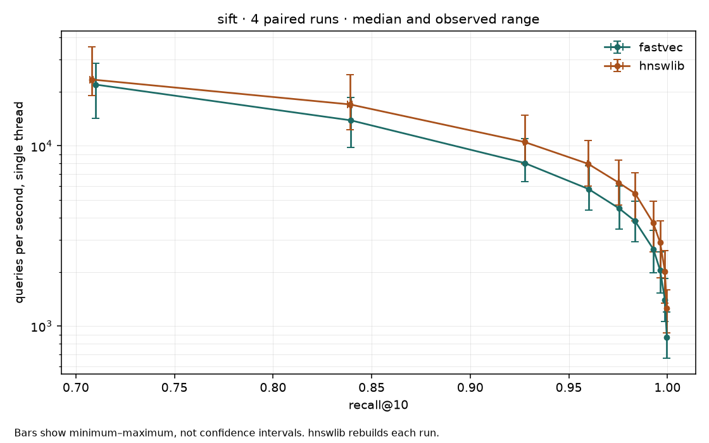

# Ubuntu benchmark baseline — 2026-10-21

Four alternating pairs per dataset measured commit
`f7d70d0f38353fbbe321d0a3efd54ab668aabdb5` on Ubuntu/WSL2,
Intel Core i7-12650H (16 logical CPUs), Go 1.26.9, Python 3.12.3,
NumPy 2.5.2 and hnswlib 0.8.0. Each implementation ran first twice.
SIFT-small completed before SIFT1M; implementations ran sequentially.

The current source includes the compact bottom-layer layout and two-pass loader.
The checkout was clean throughout measurement, and source hashes were verified
again at completion. Outputs were initially staged under ignored `bin/` and
copied here after measurement, preserving the original command paths in logs.

## Findings

hnswlib has higher median QPS at every measured ef on both datasets. Recall is
similar at higher ef, but the graphs are not identical and this is not an
exactly recall-matched comparison. Fastvec's recall is identical across its
four runs for each dataset. The SIFT1M sequential search uses an existing graph;
these results do not measure a newly constructed graph from the current code.

| Dataset / ef | Fastvec median QPS [min–max] | hnswlib median QPS [min–max] | Fastvec median recall@10 | hnswlib median recall@10 |
|---|---:|---:|---:|---:|
| SIFT-small / 100 | 12,264 [11,720–13,143] | 15,139 [14,506–15,545] | 0.9980 | 0.9980 |
| SIFT1M / 100 | 3,833 [2,936–4,921] | 5,452 [3,844–7,081] | 0.9835 | 0.9836 |
| SIFT1M / 500 | 867 [664–1,200] | 1,260 [919–1,597] | 0.9997 | 0.9997 |

These medians describe an exploratory session, not a stable performance target.
There is substantial chronological drift in SIFT1M:

| Pair | Fastvec QPS, ef=100 | hnswlib QPS, ef=100 | First implementation |
|---:|---:|---:|---|
| 1 | 2,936 | 3,883 | Fastvec |
| 2 | 2,959 | 3,844 | hnswlib |
| 3 | 4,708 | 7,081 | Fastvec |
| 4 | 4,921 | 7,021 | hnswlib |

Both implementations become much faster in later runs. The cause was not
measured: Windows host load, power mode, thermals and CPU scheduling were not
controlled. No run was discarded. The spread is too large to assess a small
optimization such as a 4–6% change. Alternating order does not remove this drift.



## Method and limits

- `search_only_repeated_sweeps_v2`, k=10, M=16, efConstruction=200,
  ef=10 through 500, one query thread, recall evaluated outside query timing.
- Four separate process runs per implementation per dataset. Ranges are
  minimum–maximum observations, not confidence intervals.
- SIFT1M has 1,000,000 128-dimensional base vectors and 10,000 queries;
  SIFT-small has 10,000 base vectors and 100 queries.
- Fastvec reuses `/mnt/d/data/sift.fvi` for SIFT1M, with full vector and persisted
  construction-parameter validation. Its original build revision and worker
  count are unknown. SIFT-small Fastvec builds a fresh graph each time.
- hnswlib builds a fresh graph in each run using its default build thread count;
  query threads are explicitly set to one. Its variation includes construction.
- Go calls Search per query; Python uses hnswlib's batch API. Their API overhead
  remains part of the measurements.
- QPS excludes index loading and construction. The `auto` loader policy was
  requested. This session does not measure a loader improvement or compare
  build times.
- These Ubuntu/WSL2 observations are separate from the earlier native Windows
  results. Differences between those sessions are not evidence of a code change
  making either platform faster or slower.

## Artifacts

- [SIFT1M summary](../bench/results/ubuntu-baseline-20261021/sift/summary.md)
- [SIFT-small summary](../bench/results/ubuntu-baseline-20261021/siftsmall/summary.md)
- [Environment and SHA-256 hashes](../bench/results/ubuntu-baseline-20261021/environment.json)
- [Complete console log](../bench/results/ubuntu-baseline-20261021/console.log)

Each dataset directory contains `session.json` with run order and exact commands,
all eight raw reports, `summary.json`, `summary.md` and `recall-qps.png`.
The environment manifest identifies the source files, binary, dataset files and
cached index by hash. Historical sessions are preserved separately.

## Reproduce

From the repository root in Ubuntu, with the existing virtual environment and
datasets available, choose new output directories:

```sh
go build -o bin/fastvec-bench-ubuntu ./cmd/fastvec-bench
py/.venv/bin/python py/repeat_benchmarks.py --fastvec bin/fastvec-bench-ubuntu --data /mnt/d/data/siftsmall --name siftsmall --runs 4 --out bin/new-ubuntu-small
py/.venv/bin/python py/repeat_benchmarks.py --fastvec bin/fastvec-bench-ubuntu --data /mnt/d/data/sift --name sift --runs 4 --index /mnt/d/data/sift.fvi --out bin/new-ubuntu-sift
py/.venv/bin/python py/plots.py --session bin/new-ubuntu-sift
```

## Next experiment

First investigate and reduce the run-to-run drift: record host power state and
background load, keep power and thermal conditions consistent, and measure the
unchanged binary repeatedly before introducing a candidate. Preserve every run
and report variation. After the baseline is sufficiently stable to distinguish
the intended effect, profile current search at ef=100 and ef=500, then compare
one targeted change using alternating baseline/candidate binaries and identical
saved graphs. Require unchanged recall and validate query results.

Follow-up: the [CPU-affinity stability experiment](search-stability-20261021.md)
compares eight unchanged-code search processes and records Windows power state.
